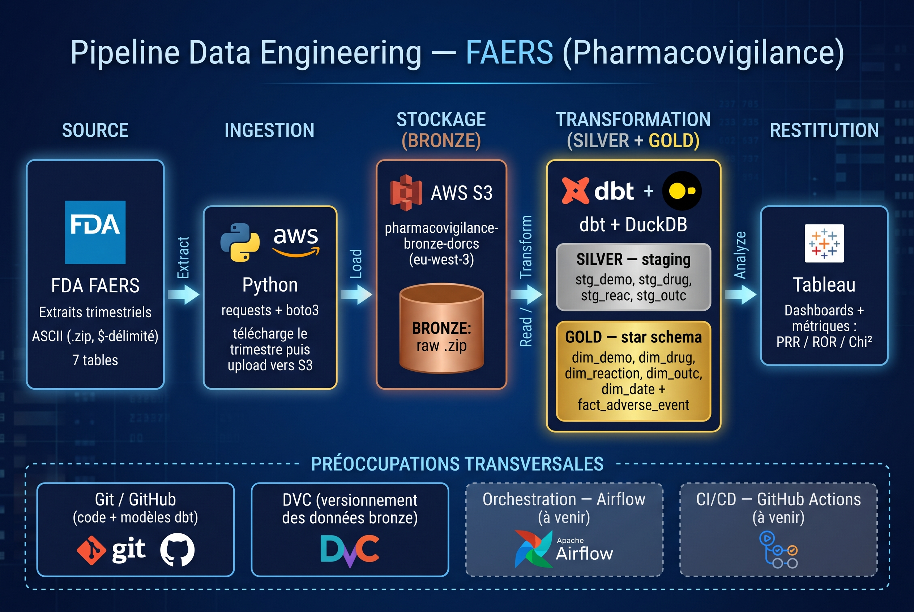

# Pharmacovigilance Data Pipeline — FDA FAERS

Pipeline de data engineering de bout en bout sur les données de pharmacovigilance
**FDA FAERS**, en architecture **médaillon** (bronze → silver → gold), avec AWS S3,
dbt et DuckDB, et restitution sous Tableau.



## 🎯 Objectif
Transformer les extraits trimestriels bruts de FAERS en un **modèle dimensionnel
(star schema)** analysable, permettant d'étudier les associations
médicament ↔ effet indésirable (base des métriques de disproportionnalité PRR / ROR).

## 🛠️ Stack technique
- **Ingestion** : Python (requests, boto3)
- **Stockage brut** : AWS S3 (bronze)
- **Versionnement** : Git (code) + DVC (données)
- **Transformation** : dbt + DuckDB (silver & gold)
- **Restitution** : Tableau

## 🏗️ Architecture médaillon
- **Bronze**: données brutes (.zip ASCII `$`-délimité) stockées sur S3, versionnées par DVC.
- **Silver**: modèles de staging dbt : lecture, nettoyage, typage (`stg_demo`, `stg_drug`, `stg_reac`, `stg_outc`).
- **Gold** star schema dbt : dimensions (`dim_demo` dédupliquée, `dim_drug`, `dim_reaction`, `dim_outc`, `dim_date`) + table de faits `fact_adverse_event`.

## 📁 Structure du projet
```
pharmacovigilance-data-pipeline/
├── data/bronze/              # données brutes (DVC)
├── src/ingestion/            # script d'ingestion Python
├── src/transformation/faers/ # projet dbt (models/staging, models/marts)
├── docs/                     # documentation, modèle de données
├── images/                   # images
└── requirements.txt
```

## 🚀 Reproduire le pipeline

### 1. Environnement

```bash
python3 -m venv .venv
source .venv/bin/activate
pip install -r requirements.txt
```

### 2. Configurer les credentials AWS (aws configure) + le .env

### 3. Récupérer la donnée bronze

```bash
dvc pull
unzip data/bronze/faers_ascii_2026q2.zip -d data/bronze/faers_ascii_2026q2
```

### 4. Ingestion (optionnel, pour un nouveau trimestre)

```bash
python src/ingestion/download_faers.py
```

### 5. Transformations dbt

```bash
cd src/transformation/faers
dbt run
dbt test
​```