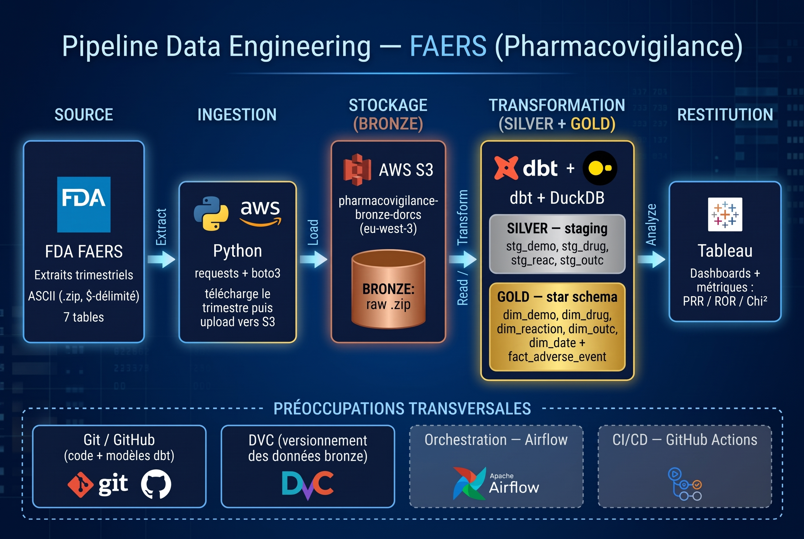

# Pharmacovigilance Data Pipeline — FDA FAERS

Pipeline de data engineering de bout en bout sur les données de pharmacovigilance
**FDA FAERS** (4 trimestres : 2025 Q3 → 2026 Q2), en architecture **médaillon**
(bronze → silver → gold) avec AWS S3, dbt et DuckDB, et restitution sous Tableau.



## 🎯 Objectif
Transformer les extraits trimestriels bruts de FAERS en un **modèle dimensionnel
(star schema)** analysable, et **calculer des métriques de disproportionnalité
(PRR / ROR / IC95 / chi²)** pour la détection de signal médicament ↔ effet
indésirable — avec le cadrage scientifique associé (un signal est une hypothèse,
pas une preuve de causalité).

## 🛠️ Stack technique
- **Ingestion** : Python (requests, boto3)
- **Stockage brut** : AWS S3 (bronze)
- **Versionnement** : Git (code) + DVC (données)
- **Transformation** : dbt + DuckDB (silver & gold)
- **Analyse** : mart de disproportionnalité (PRR / ROR / IC95 / chi²)
- **Orchestration** : Airflow (Astro)
- **Restitution** : Tableau (à venir)

## 🏗️ Architecture médaillon
- **Bronze**: données brutes (.zip ASCII `$`-délimité) stockées sur S3, versionnées par DVC.
- **Silver** : modèles de staging dbt (lecture, nettoyage, typage, clés normalisées) : `stg_demo`, `stg_drug`, `stg_reac`, `stg_outc`, `stg_deleted`.
- **Gold** : star schema dbt —
  - **dimensions** : `dim_demo` (dédupliquée, cas supprimés exclus), `dim_drug`, `dim_active_ingredient`, `dim_reaction`, `dim_outc`, `dim_date` ;
  - **faits** : `fact_adverse_event` (cas × médicament suspect × réaction), `fact_case_outcome` (cas × issue) ;
  - **mart analytique** : `signal_disproportionality` (PRR / ROR / IC95 / chi² + flag `is_signal`).

## 📁 Structure du projet
```
pharmacovigilance-data-pipeline/
├── data/bronze/              # données brutes (DVC)
├── src/ingestion/            # script d'ingestion Python
├── src/transformation/faers/ # projet dbt (models/staging, models/marts)
├── docs/                     # documentation, modèle de données
├── images/                   # images
├── orchestration             # orchestration airflow(Astro)
└── requirements.txt
```

## 🚀 Reproduire le pipeline

### 1. Environnement

```bash
python3 -m venv .venv
source .venv/bin/activate
pip install -r requirements.txt
```

### 2. Créer le fichier .env à la racine du projet contenant `AWS_ACCESS_KEY_ID`, `AWS_SECRET_ACCESS_KEY`, `AWS_DEFAULT_REGION` et `S3_BUCKET_NAME`. Ne pas ajouter ce fichier au dépôt Git.

### 3. Récupérer la donnée bronze

```bash
dvc pull
python -m src.ingestion.unzip_faers --year 2026 --quarter 2
```

### 4. Ingestion (optionnel, pour un nouveau trimestre)

```bash
python -m src.ingestion.download_faers --year 2026 --quarter 2
```

### 5. Transformations dbt

```bash
cd src/transformation/faers
dbt build   # construit les modèles puis lance les tests (clés, FK, grain)
```
